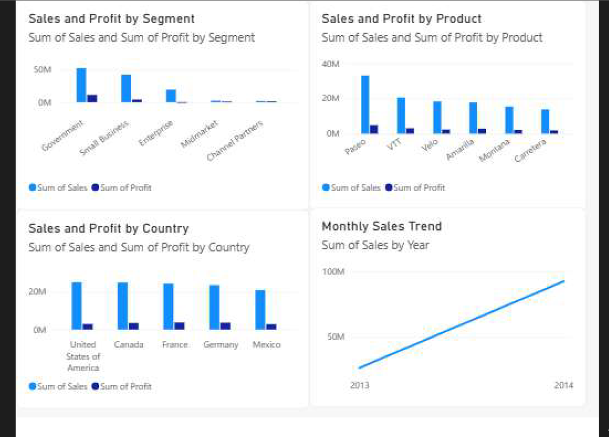

# Sales Profitability Dashboard | Python, Excel, Power BI

## Objective
Find which customer segments and discount levels drive profit or loss
in a sales dataset of 700 orders ([currency] 118.7M in sales).

## Tools
Python (Pandas), Excel, Power BI

## Process
1. Data cleaning: [removed duplicates, handled missing values, fixed date formats]
2. EDA: compared sales, profit and discount by segment
3. Dashboard: built an interactive Power BI dashboard with [KPIs / filters you used]

## Key finding
The Enterprise segment loses money on High and Medium discount orders,
while all other segments stay profitable.

## Recommendation
[One sentence, e.g. cap discounts for Enterprise orders at X%]

## Screenshots

## Files
- Dashboard_Report.pdf
- Dashboard.pbix
